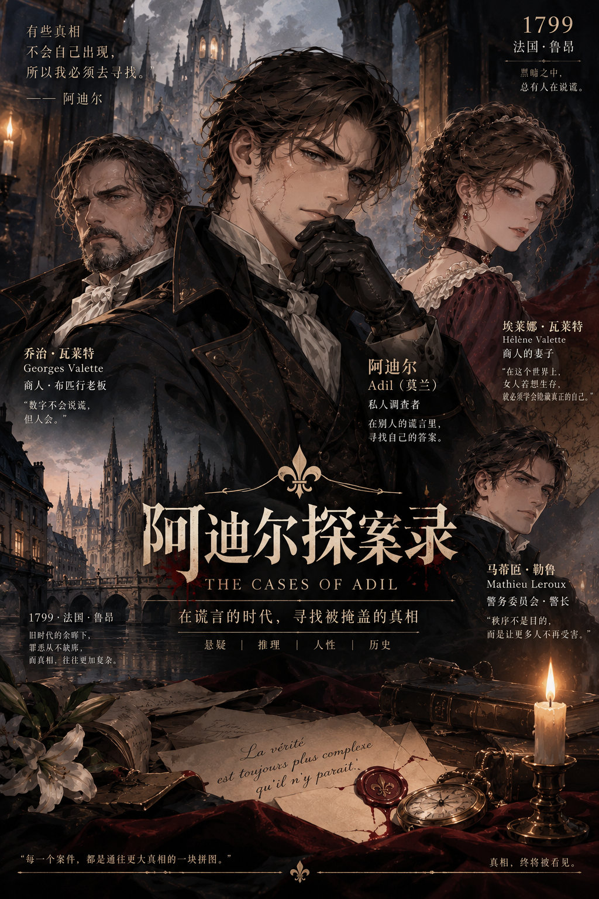
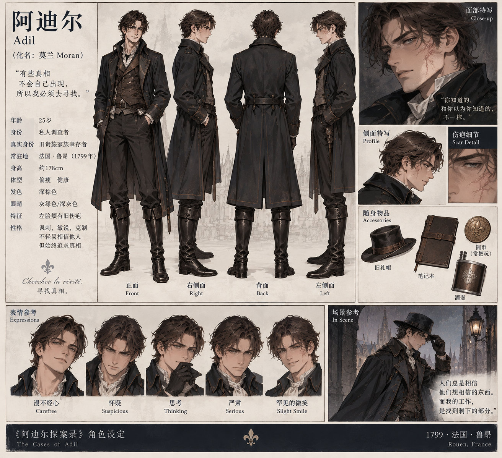
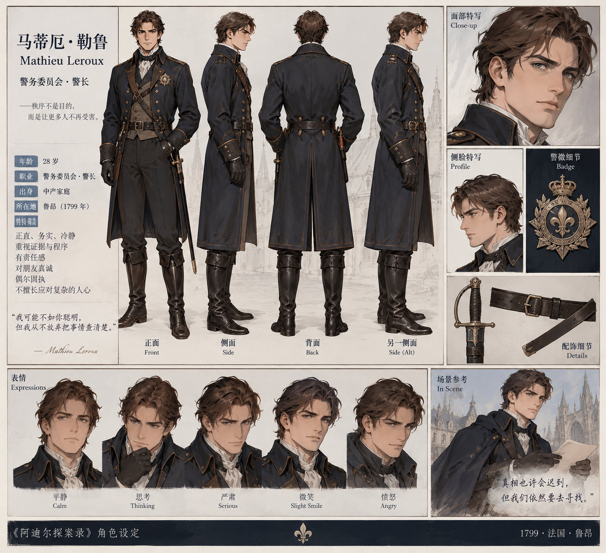
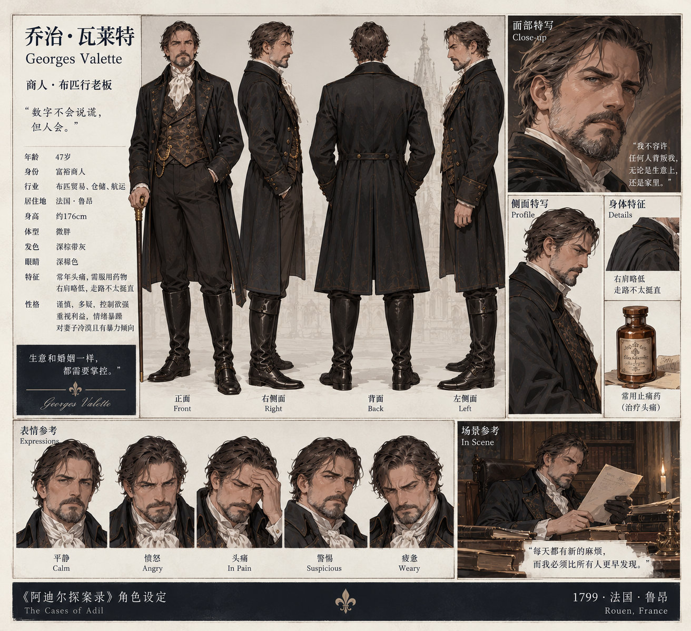

## 人物四视图

### 阿迪尔 · Adil

### 马蒂厄·勒鲁 · Mathieu Leroux

### 乔治·瓦莱特 · Georges Valette

### 埃莱娜·瓦莱特 · Hélène Valette

# 阿迪尔探案录

**历史悬疑推理小说 · 连载试写版**

1799年，法国鲁昂。一个被世人认定已经死亡的旧贵族青年，隐姓埋名，以私人调查谋生。他叫阿迪尔，也使用“莫兰”这个名字。

他不断追查别人的秘密，却始终无法解开自己人生中最大的谜团：妹妹为何死于那场针对家族的袭击，以及父亲究竟隐瞒了什么。

## 第一案：《死者的最后一封信》

一位布匹商人死在自己的书房，现场似乎指向服药自杀。然而邻居、仆人和一份深夜商业记录，都声称他在不同时间仍然活着。阿迪尔必须从证词与物证中辨别事实，重新审视这场死亡。

### 已发布章节

1. [第一章：清晨的死者](chapters/01-清晨的死者.md)
2. [第二章：八点的身影](chapters/02-八点的身影.md)
3. [第三章：货仓里的三箱布](chapters/03-货仓里的三箱布.md)

### 连载说明

- 当前内容为**创作试写稿**，情节与历史细节仍会在后续审稿时调整。
- 尚未写出的章节不列为已发布。
- 本仓库以 Markdown 保存章节，每章独立文件，并通过目录串联阅读。
- 人物、财产法律和1799年法国相关细节以最终考证版本为准。

> 创作形式：原创故事构思与 AI 辅助写作、编辑。
